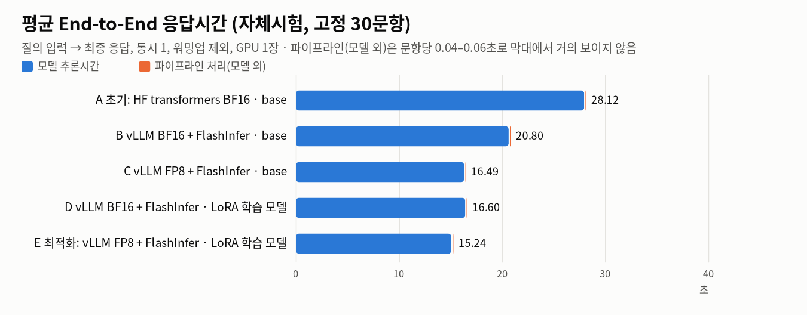
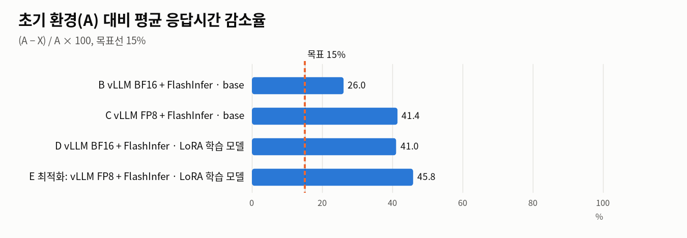
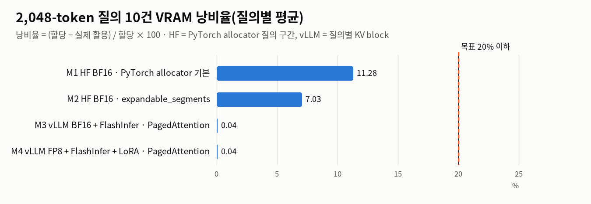
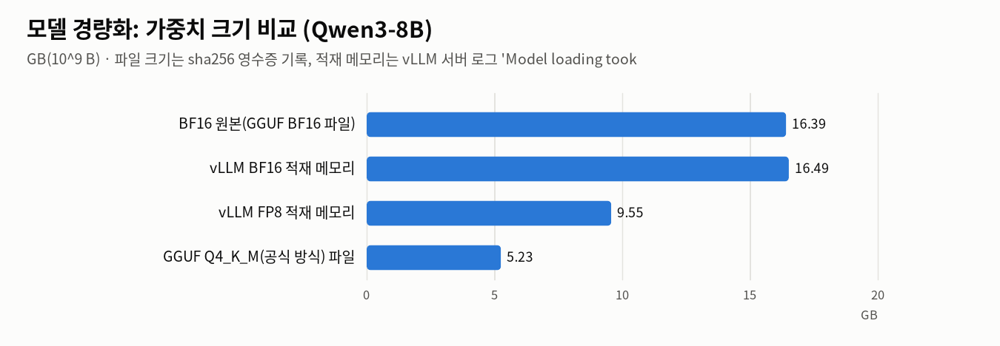
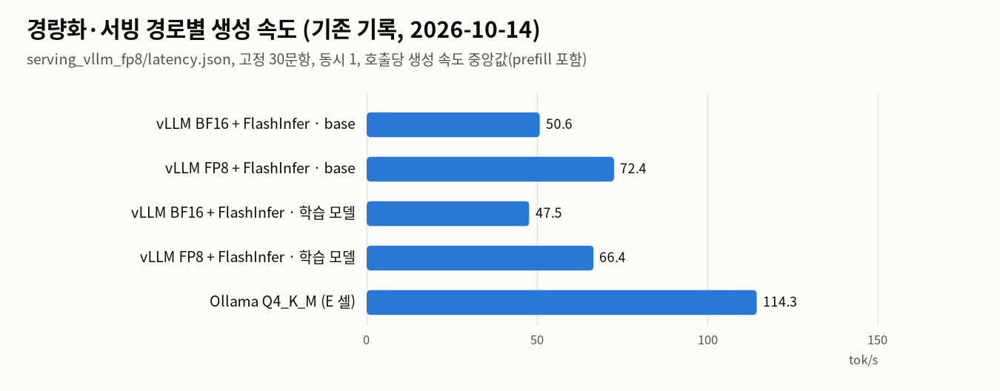

# 이기종 컴퓨팅 기반 AI 성능 최적화 — 최종 결과보고서 초안

- 작성일: 2026-11-24 / 작성 브랜치: `geoflow/final-report-perf` (기준 커밋 `2c4646bc`, `geoflow/sft-dpo-t2pc`)
- 대상 시스템: 자연어 교통 질의 → LLM 개념·조건 추출(grounding JSON) → 결정적 계획·검증·도구 실행 → 답변 생성
- 수치 출처 구분
  - **[자체시험]** 2026-11-24 본 보고서용으로 새로 측정한 값 (원자료 `logs/`, 집계 `summary.json`)
  - **[기존 기록]** 저장소에 이미 있는 자체 실험 기록에서 옮긴 값 (경로 명시, 재측정 안 함)
  - **[공인시험]** 해당 없음 — 저장소 안에 시험합의서·공인시험성적서·공인시험 결과 기록이 없음. 본 문서의 모든 수치는 자체시험 또는 기존 자체 실험 기록임
- 신규 모델 학습·모델 다운로드·기존 연구 코드 및 평가 결과 수정은 하지 않음 (측정 도구는 `final_report/tools/`에 새 파일로 작성)

---

## 2.5 이기종 컴퓨팅 기반 AI 성능 최적화

### 2.5.1 CPU/GPU 역할 분리 및 실행 구조

- **GPU 담당: LLM 추론 1단계만 수행**
  - Qwen3-8B(+LoRA 어댑터)가 질의에서 개념·역할·조건(factors)을 추출한 grounding JSON만 생성
  - 그래프·도구 호출은 생성하지 않음 (`training/ARCHITECTURE.md`)
- **CPU 담당: 결정적(deterministic) 후처리 전체**
  - 응답 파싱·스키마 검사(`parse_grounding`), 조건 정규화·조건 계층(`conditions.py`)
  - 매크로 조합(`MacroComposer`), 계획 검증 G1–G7(`validator.py`), 컴파일·실행(`compiler.py`, `executor.py`), TIMS 도구 호출, 답변 작성(`answer.py`)
  - 클라이언트 측 토크나이징(vLLM 경로는 CPU에서 token id를 만든 뒤 서버로 전송)
- **CPU 전용 오프라인 작업**
  - LoRA 병합본 → GGUF BF16 변환 → Q4_K_M 양자화(llama.cpp b11434 CPU 빌드 `llama-quantize`)
  - 학습 데이터 구성·토큰 길이 검사·채점·통계 집계
- **[자체시험] 역할 분리 효과 실측**: E2E 응답시간 중 CPU 후처리(모델 외 파이프라인) 비중
  - 문항당 평균 0.045–0.061초, 최대 0.062초 (5개 구성 공통), 전체 응답시간의 0.16–0.39%
  - 응답시간의 99.6% 이상(99.61–99.84%)이 GPU 모델 추론 → 최적화 대상을 GPU 추론 경로로 집중한 근거

### 2.5.2 추론 실행환경 최적화 (vLLM · FlashInfer · Ollama)

| 구분 | 적용 내용 | 근거 |
|---|---|---|
| 초기 환경 | HF transformers 4.56.2 BF16 + SDPA, 프로세스 안 단일 요청 생성 | `sft_dpo_inventory/thinking_prep_001/hf_eval_thinking.py` |
| vLLM 서빙 | vLLM 0.30.0, BF16, PagedAttention KV cache, prefix cache, LoRA 어댑터를 병합 없이 서버에 적재(`--enable-lora`) | `sft_dpo_inventory/serving_vllm/REPORT.md` |
| FlashInfer | attention backend `FLASHINFER` + FlashInfer top-p/top-k sampler (flashinfer 0.6.18.post1) | `sft_dpo_inventory/serving_vllm_fp8/REPORT.md` 1절 |
| FP8 | vLLM 온라인 FP8 가중치 양자화(`--quantization fp8`, per-tensor, CutlassFP8ScaledMM) + LoRA | 같은 문서 0절 |
| Ollama/GGUF | llama.cpp GGUF Q4_K_M(공식 방식, attn_v F16) → Ollama 등록, 4비트 경량 배포 경로 | `sft_dpo_inventory/quant_recipe/RECIPE.md`, `pilot_010/results/JV_RESULTS.md` |

- FlashInfer 적용 과정 (기존 기록)
  - 1차: nvcc 13.4와 CUDA 런타임 헤더 13.0 불일치로 JIT 빌드 실패 → venv에 CUDA 13.0.88 툴킷 설치
  - 2차: `-lcudart` 링크 실패 → 저장소 밖 링크 폴더를 `LIBRARY_PATH`에 지정
  - 3차: 성공, 서버 로그에 `AttentionBackendEnum.FLASHINFER`, "Using FlashInfer for top-p & top-k sampling" 확인
  - 이번 자체시험 서버 로그에서도 동일 문구 재확인 (`logs/latency/server_{bf16,fp8}.json`)
- 정합성 확인 (기존 기록)
  - HF ↔ vLLM 입력 token id열 10/10 일치, token 확률 차이 |Δlog p| 0.012 (HF 병합본·llama.cpp BF16 차이와 같은 수준)
  - FlashInfer 적용 전후 token 확률 차이 변화 없음 (0.0124 → 0.0125)

### 2.5.3 모델 경량화 (양자화 · LoRA)

- **FP8 (vLLM 온라인 양자화)**: 같은 BF16 체크포인트에서 서버 기동 시 FP8로 변환, 별도 파일 없음
- **GGUF Q4_K_M (llama.cpp)**: 공식 qwen3:8b와 텐서 타입 399/399 동일하도록 attn_v만 F16 지정 (`llama-quantize --tensor-type attn_v=f16`)
- **LoRA**: rank 16, alpha 32, 7개 projection(q/k/v/o/gate/up/down)만 학습, 기반 가중치 고정

### 2.5.4 경량 학습 (LoRA · SFT · DPO)

- BF16 LoRA SFT: completion-only loss, gradient checkpointing(non-reentrant), SDPA, batch 1
- DPO: 고정 SFT 어댑터를 reference로 사용, reference log-prob 사전 계산(precompute) 또는 공유 어댑터(shared adapter) 방식으로 reference 모델 복제 제거
- 학습 allocator 설정: `PYTORCH_CUDA_ALLOC_CONF=expandable_segments:True` (결정 17)
- 학습 데이터·평가 셋 분리, 보호 셋(protected_final_v1/v2)은 학습·선택에 사용하지 않음 (`sft_dpo_inventory/DECISIONS.md`)

### 2.5.5 Jetson AGX Thor 실행환경 구축 (기존 기록)

- 장비: `hpclab-thor2`, Ubuntu 24.04.5 aarch64, JetPack 7.1-b112 / L4T 38.4.0, CUDA 13.0, NVIDIA Thor(compute capability 11.0), 통합 메모리 122.82 GiB, 전원 모드 120W
- 기존 `vllm/vllm-openai:v0.28.0` ARM64 이미지(torch 2.13.0+cu130) 재사용, 별도 venv에 transformers 4.56.2 · TRL 0.23.1 · PEFT 0.17.1 구성
- 호환성: CUDA 인식·BF16·SDPA·BF16 LoRA 학습 PASS / bitsandbytes·QLoRA·flash-attn 미설치(NOT TESTED)
- 근거: `training/THOR_VALIDATION.md`, `training/THOR_V003_TOKEN_VALIDATION.md`

### 2.5.6 성능시험 방법 (자체시험, 2026-11-24)

- 시험 장비: workstation4 — Intel Xeon Gold 6526Y × 2(64 논리 코어), RAM 251 GiB, NVIDIA RTX 6000 Ada 48 GB × 4, 드라이버 595.99.02 (`environment.json`)
- **응답 지연시간**
  - 같은 GPU 1장(index 3, `GPU-48f798cc…`)에서 5개 구성을 순차 측정, 다른 GPU 작업 없음 확인(`logs/latency/gpu_check.txt`)
  - 입력: 기존 지연시험 고정 30문항(`serving_vllm_fp8/latency_ids.txt`, 결정 93·113에서 사용한 대표 교통 질의), 모든 구성 동일
  - 모델 적재(HF 프로세스 적재, vLLM 서버 기동)와 워밍업 3문항(측정 문항과 겹치지 않음)은 본 측정에서 제외하고 따로 기록
  - E2E 정의: 질의 문자열을 파이프라인에 넣은 순간 → 최종 응답(답변 또는 사용자 안내 메시지) 출력까지 (`perf_counter`), 채점 시간 제외
  - 모델 추론시간(LLM 호출 합, 재질의 포함)과 파이프라인 처리시간(E2E − 모델)을 분리 기록
  - 동시 요청 1, thinking 켬, sampling(T 0.6·top-p 0.95·top-k 20·seed 20261101), 생성 상한 8,192 token
  - 정상 응답 판정(측정 전 고정): 예외 없음 ∧ 모델 호출 실패 없음 ∧ 생성 상한 잘림 없음 ∧ E2E ≤ 120초. 120초 초과는 타임아웃으로 기록(요청은 끊지 않음)
  - 개선율 = (초기 평균 − 최적화 평균) / 초기 평균 × 100, 95% 구간은 문항 쌍 bootstrap 10,000회
- **GPU 메모리 활용 효율**
  - GPU 1장(index 2, `GPU-c8f1bae2…`)
  - 입력: 실제 Qwen3-8B 토크나이저 기준 정확히 2,048 token인 장문 질의 10건 (`data/vram_inputs_2048.jsonl`)
    - 평가 개발 셋(`selection_gold.yaml`)의 실제 교통 질의 60여 개를 질의마다 다른 순서로 이어 붙인 뒤 chat template(thinking 켬) 포함 2,048 token으로 맞춤
  - 생성: greedy, 정확히 256 token (질의당 처리 token 2,304로 동일)
  - 측정 방법 (할당·실사용을 같은 시점·같은 범위로 산출)
    - vLLM(PagedAttention): engine step마다 같은 순간에 **질의에 배정된 KV block × block 크기 × token당 KV 바이트(할당)** 대 **KV가 실제로 채워진 token × token당 KV 바이트(실사용)**, 질의별 최대 배정 순간 값 사용. 미리 잡은 KV pool 전체(gpu_memory_utilization)는 할당으로 보지 않음
    - HF(PyTorch caching allocator): 질의마다 cache 비우고 peak 초기화 → 같은 구간의 `max_memory_reserved`(할당) 대 `max_memory_allocated`(실사용). 질의 범위는 상주 가중치(적재 직후 allocated)를 양쪽에서 뺀 값
  - VRAM 낭비율 = (할당 − 실제 활용) / 할당 × 100

---

## 3.6 이기종 컴퓨팅 기반 AI 성능 최적화 성과

### 3.6.1 응답 지연시간 [자체시험]

| 구성 | 평균 E2E (초) | 중앙값 | p95 | 모델 추론 평균 | 파이프라인(모델 외) 평균 | 생성 token 평균 | 정상 응답 | 타임아웃 | 실패(예외) |
|---|---:|---:|---:|---:|---:|---:|---:|---:|---:|
| A 초기: HF transformers BF16 · base | **28.117** | 22.244 | 54.497 | 28.072 | 0.045 | 1,057.4 | 30/30 | 0 | 0 |
| B vLLM BF16 + FlashInfer · base | 20.803 | 16.264 | 40.038 | 20.744 | 0.059 | 1,051.6 | 30/30 | 0 | 0 |
| C vLLM FP8 + FlashInfer · base | 16.490 | 11.927 | 26.851 | 16.430 | 0.060 | 1,184.7 | 30/30 | 0 | 0 |
| D vLLM BF16 + FlashInfer · LoRA 학습 모델 | 16.602 | 14.486 | 21.305 | 16.542 | 0.061 | 789.8 | 30/30 | 0 | 0 |
| E 최적화: vLLM FP8 + FlashInfer · LoRA 학습 모델 | **15.245** | 9.832 | 18.125 | 15.185 | 0.060 | 999.7 | 29/30 | **1** | 0 |

- 적재·워밍업(본 측정 제외): HF 모델 적재 10.2초 / vLLM 서버 기동~준비 BF16 54.3초, FP8 102.7초 / 워밍업 3문항
- **타임아웃 1건(E, `indepv4/k28`)**: 첫 호출이 생성 상한 8,192 token에 걸려 142.7초 소요 → 파이프라인 재질의로 최종 답변은 정상 출력. 정상 응답 판정 기준으로는 비정상 처리
- 응답 결과(참고, 정확도 판정 아님): 답변 출력 A 25 · B 24 · C 25 · D 27 · E 27 / grounding 일치 A 20 · B 21 · C 20 · D 27 · E 25 (30문항 중)

| 비교 (초기 A 대비) | 평균 E2E 감소율 | 95% 구간 | 모델 추론시간 감소율 | 중앙값 감소율 |
|---|---:|---|---:|---:|
| A → B (vLLM + FlashInfer) | 26.01% | [11.65, 37.35] | 26.10% | 26.88% |
| A → C (+ FP8) | 41.35% | [24.30, 54.35] | 41.47% | 46.38% |
| A → D (+ LoRA 학습 모델) | 40.95% | [21.83, 53.66] | 41.07% | 34.88% |
| **A → E (최종 최적화)** | **45.78%** | [3.59, 67.22] | 45.91% | 55.80% |
| 참고(민감도): A → E, 타임아웃 문항 1건 제외(29문항) | 61.82% | [52.71, 68.88] | – | – |

- 단계별 기여(같은 30문항): vLLM+FlashInfer 26.0% → FP8 추가(B→C) 20.7% [−4.0, 38.7] / LoRA 학습 모델(B→D) 20.2% [3.6, 36.4] (생성 token 1,052 → 790으로 감소)
- A → E 구간 하한이 3.59%로 넓은 것은 타임아웃 1문항(142.7초)의 영향. 해당 문항 제외 시 하한 52.71%

### 3.6.2 GPU 메모리 활용 효율 [자체시험]

| 구성 | 측정 범위 | 질의당 할당 (MiB) | 질의당 실제 활용 (MiB) | 낭비율 평균 | 낭비율 최대 |
|---|---|---:|---:|---:|---:|
| M1 HF BF16 · allocator 기본 (초기) | PyTorch allocator 질의 구간 | 569.4 | 505.2 | 11.28% | 11.28% |
| M2 HF BF16 · expandable_segments | PyTorch allocator 질의 구간 | 543.4 | 505.2 | 7.03% | 7.03% |
| M3 vLLM BF16 + FlashInfer · base | 질의별 KV block | 324.0 | 323.86 | 0.043% | 0.043% |
| **M4 vLLM FP8 + FlashInfer + LoRA (최적화)** | 질의별 KV block | 324.0 | 323.86 | **0.043%** | 0.043% |

- vLLM: 질의당 KV block 144개(block 16 token, token당 KV 144 KiB) 배정, 2,304칸 중 2,303 token 채움 → 미사용 1칸
  - step별 낭비율 0–0.73% (decode 중 마지막 block 일부 비어 있는 구간), 10건 모두 동일
  - 참고: 서버가 미리 잡은 KV pool은 BF16 23,103 MiB(10,268 block), FP8 28,701 MiB(12,756 block) — 동시 요청용 예약 영역으로 질의 할당에 넣지 않음
- HF: 프로세스 전체 기준(가중치 포함) 낭비율은 M1 0.40%, M2 0.24%. 질의 구간 기준 11.28% → 7.03%
- 10건 모두 정상 처리(생성 256 token), 측정 실패 없음. 질의별 값은 `vram_results.csv`
- FP8 적용 시 같은 GPU에서 KV cache 수용량 증가: 서버 로그 기준 168,896 → 204,432 token (+21.0%) — 가중치 적재 메모리 15.36 → 8.89 GiB

### 3.6.3 모델 경량화 비교

| 형식 | 크기 | 감소율 (BF16 대비) | 출처 |
|---|---:|---:|---|
| BF16 (GGUF BF16 파일) | 16,388,044,160 B | – | [기존 기록] gguf 영수증 |
| vLLM BF16 적재 메모리 | 15.36 GiB | – | [자체시험] 서버 로그 |
| vLLM FP8 적재 메모리 | 8.89 GiB | 42.1% (적재 메모리 기준) | [자체시험] 서버 로그 |
| GGUF Q4_K_M 공식 방식 | 5,225,375,104 B | 68.1% (파일 기준) | [기존 기록] `quant_recipe/RECIPE.md` |
| LoRA 어댑터(V4 o101) | 174,655,536 B | 기반 모델의 1.07% | [기존 기록] 파일 크기 |

| 정밀도별 정확도·충실도 (기존 기록) | 값 | 출처 |
|---|---|---|
| token 확률 차이 \|Δlog p\| (HF 대비) | vLLM BF16 0.0125 / FP8 0.0407 / GGUF Q8_0 0.0168 / Q4_K_M 0.0957 | `serving_vllm_fp8/REPORT.md` 2절 |
| 학습 신호 보존율 (최종 − base) | BF16 1.003 / FP8 0.987 | 같은 문서 |
| FP8 생성 속도 (BF16 대비) | 1.40–1.44배, 문항 지연 0.71–0.72배 | 같은 문서 5절 |
| FP8-최종 정답률 (BF16-최종 대비, selection_v2 98문항 k=4) | −3.83%p [−7.40, −0.51] (저하 확인됨) | 같은 문서 3절 |
| Q4_K_M − BF16 H-final 정답률 (같은 어댑터) | −0.56 ~ −4.20%p | `pilot_010/results/JV_RESULTS.md` |
| Ollama Q4_K_M 측정 중 GPU 메모리 (8B) | 7,881 MiB (vLLM BF16 예약 42,371 MiB) | 같은 문서 표 5 |

### 3.6.4 경량 학습(LoRA · SFT · DPO) 성과 (기존 기록)

| 항목 | 값 | 출처 |
|---|---|---|
| V4 LoRA SFT (RTX 6000 Ada 1장, 1 epoch 1,984 step) | 5.73–5.92 초/step, 총 11,469–11,852초(판정용 o101 11,476초), 1,365–1,412 token/s | `pilot_010/train_logs/migration_20261028/home/train_s10/S-V4-*_profile.json`(선택 단계 seed 3개), `pilot_010/gpu/J/T-J-V4-o101.log` |
| 학습 GPU 메모리 peak | allocated 37.04 GiB / reserved 40.89–40.97 GiB (48 GB 장비 안에서 수행, o101도 allocated 37.04 GiB) | 같은 파일 |
| DPO reference 사전 계산 효과 (같은 레코드) | tensor 사용량 42.12 → 35.00 GiB (−7.1 GiB), nvidia-smi peak −3,286 MiB | `pipeline_pilot_001/REPORT.md` 3절 |
| Thor DPO reference 방식 비교 | full reference 46.90 → shared adapter 31.48 GiB (−15.42 GiB) → precompute 27.85 GiB | `training/THOR_VALIDATION.md` |
| DPO 학습 효과 (pilot_003 최종, selection_v2) | HF +6.89%p [1.28, 13.01], vLLM +8.42%p [3.06, 13.78] | `serving_vllm/REPORT.md` 4절 |
| V4 학습 효과 (pilot_010 판정, 보호 셋) | 올바른 거부 base 48.75 → V4 82.0% (+33.25%p [19.4, 46.9]) | `pilot_010/results/J_RESULTS.md` |
| 같은 판정의 미달 항목 | 과잉 거부 C3 미달(+6.85%p), H-final 정답률 C4 미달(86.22 < 88.85) | 같은 문서 |
| 학습 모델의 생성 길이 감소 [자체시험] | 평균 생성 token 1,051.6 → 789.8 (B→D, −24.9%) | `summary.json` |

### 3.6.5 Jetson AGX Thor 실행환경 (기존 기록)

| 항목 | SFT | DPO |
|---|---:|---:|
| 최장 레코드 peak allocated / reserved (GiB) | 29.65 / 33.31 | 32.42 / 34.89 |
| 최소 시스템 가용 메모리 (GiB) | 80.73 | 79.20 |
| sec/step (2 step probe) | 16.42 | 52.43 |
| policy token/s | 424.90 | 266.14 |
| GPU 최대 온도 (°C) | 47.16 | 54.97 |

- 8B 실모델 BF16 LoRA SFT·DPO의 forward/backward/optimizer/저장까지 OOM 없이 동작 확인, 테스트 1,184건 OK
- **측정 불가 항목**: Thor에서의 추론 응답시간·vLLM 서빙·장시간 학습은 기록 없음, 이번 작업에서 장비에 접속하지 않아 측정하지 않음

---

## 4.2 정량적 성과목표 달성 결과

| 성과지표 | 목표 | 결과 | 달성 여부 | 시험 구분 | 근거 |
|---|---|---|---|---|---|
| 평균 End-to-End 응답시간 감소율 (초기 HF BF16 base → 최적화 vLLM FP8+FlashInfer+LoRA) | 15% 이상 | **45.78%** (28.117초 → 15.245초), 95% 구간 [3.59, 67.22] | **달성** | 자체시험 | `latency_results.csv`, `summary.json` |
| 2,048 token 장문 질의 10건 VRAM 낭비율 (최적화 구성) | 20% 이하 | **0.043%** (10건 평균·최대 동일) | **달성** | 자체시험 | `vram_results.csv`, `summary.json` |
| (참고) 초기 구성 VRAM 낭비율 (HF BF16, allocator 기본) | – | 11.28% (질의 구간) | 목표 범위 안 | 자체시험 | 같음 |

- 공인시험 결과: **없음** (시험합의서·공인시험 기록이 저장소에 없음). 공인시험이 필요하면 위 자체시험 방법(`logs/COMMANDS.md`)을 시험 절차 초안으로 사용 가능
- 응답시간 목표 관련 유의사항
  - 정상 응답 29/30 (타임아웃 1건, 최종 답변은 출력됨). 해당 문항을 빼도 감소율 61.82%로 목표 초과
  - 초기 환경을 **Ollama Q4_K_M(기존 운영 4비트 경로)**로 정의하면 결과가 다름: [기존 기록] 같은 30문항에서 Ollama Q4 base 평균 11.48초, Q4 학습 모델 평균 14.23초(잘림 3건 포함) — 최적화 E(15.245초)보다 빠름. 본 성과지표는 학습·평가 기준 경로인 HF BF16을 초기 환경으로 정의함
  - 자체시험의 개선율에는 실행환경 개선(vLLM·FlashInfer·FP8)과 학습 모델의 생성 길이 감소가 함께 들어 있음(3.6.1 단계별 기여 참조)
- VRAM 목표 관련 유의사항
  - vLLM 낭비율은 질의별 KV cache 범위 값임. 가중치·활성화 메모리와 미리 예약한 KV pool은 이 범위에 넣지 않음
  - 초기 HF 구성도 질의 구간 기준 11.28%로 20% 이하였음 (2,048 token 단일 질의·순차 처리 조건)

## 4.3 정성적 성과목표 달성 결과

- **이기종 실행 구조 확립**
  - GPU는 grounding JSON 생성만, CPU는 파싱·검증·계획·실행·답변 전체를 담당하는 구조로 분리
  - 실측상 CPU 후처리는 문항당 0.06초 이하(응답시간의 0.4% 이하) → GPU 추론 최적화가 전체 응답시간에 그대로 반영되는 구조 확인
- **서빙 엔진 다변화 및 검증**
  - HF transformers(학습·기준), vLLM(BF16/FP8, FlashInfer, LoRA 동적 적재), Ollama/llama.cpp(GGUF Q4_K_M) 3개 경로 구축
  - 경로 간 입력 token 일치·token 확률 차이·학습 효과 보존을 정량 확인한 뒤 사용
- **FlashInfer 적용**: CUDA 툴킷 판 불일치·링크 문제를 해결해 attention·sampler 모두 FlashInfer로 동작, 기존 서버 스크립트에 옵션으로 통합
- **양자화 경로 확보**: FP8(vLLM 온라인)·GGUF Q4_K_M(공식 텐서 구성 재현) 두 방식 확보, 각 방식의 속도·메모리·정확도 영향 기록
  - 한계: FP8 최종 모델 정답률 −3.83%p 저하 확인 → 정밀도 후보 규칙상 운영 정밀도는 BF16으로 판정(사용자 확인 대기 상태로 기록됨)
- **경량 학습 체계 구축**: BF16 LoRA SFT·DPO 학습 파이프라인, reference 사전 계산·공유 어댑터로 DPO 메모리 절감, 48 GB GPU 1장에서 8B 모델 학습 수행
  - 한계: 최종 판정(pilot_010)에서 과잉 거부·H-final 정답률 기준은 미달
- **엣지 장비(Jetson AGX Thor) 실행환경 구축**: aarch64·CUDA 13·통합 메모리 환경에서 8B BF16 LoRA SFT/DPO 동작과 메모리·속도 실측 확보
  - 미완료: Thor 추론 서빙 성능, QLoRA·flash-attn, 장시간 학습 안정성 미검증
- **재현 가능한 시험 체계**: 고정 문항·고정 seed·커밋 고정 worktree·GPU UUID 확인·원자료 보존 방식으로 시험 절차 정리 (`logs/`)

---

## 부록 A. 산출물

| 파일 | 내용 |
|---|---|
| `environment.json` | 시험 장비 하드웨어·소프트웨어, 모델·어댑터 해시, Thor 환경(기존 기록) |
| `latency_results.csv` | 5개 구성 × 30문항 질의별 E2E·모델·파이프라인 시간, 정상 여부, 타임아웃·실패 |
| `vram_results.csv` | 4개 구성 × 10질의 할당·실사용 메모리, 낭비율 |
| `summary.json` | 성과지표·달성 여부·구성별 통계·비교·기존 기록 요약 |
| `figures/` | 응답시간, 감소율, VRAM 낭비율, 가중치 크기, 생성 속도 (SVG·PNG) |
| `logs/` | 실행 명령(`COMMANDS.md`), runs.log, GPU 확인, 셀별 결과 JSON·로그, 응답 원문(raw), vLLM 서버 로그 |
| `tools/` | 측정·집계 스크립트 (새 파일, 기존 연구 코드 수정 없음) |
| `data/vram_inputs_2048.jsonl` | 2,048 token 입력 10건 (token id·출처 질의 id·sha256) |

## 부록 B. 시험 조건의 한계

- 자체시험 표본은 30문항 × 1회(지연), 10질의(VRAM)로 소규모임. 30문항은 기존 지연 시험과 같은 고정 문항
- sampling 생성이라 구성마다 생성 길이가 다르며, 개선율에는 생성 길이 차이가 섞여 있음
- vLLM과 HF의 VRAM 측정 범위가 다름(KV block 대 allocator 질의 구간). 각 엔진의 메모리 관리 구조에 맞춘 방법이며 범위는 표에 명시함
- 기존 기록 수치는 측정 시점·GPU·셋이 각각 다르므로 서로 직접 비교하지 않음
